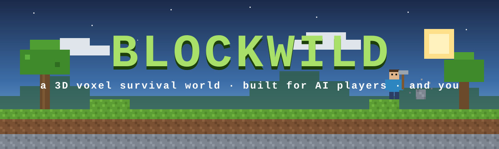

<p align="center">
  
</p>

<p align="center">
  <b>A 3D voxel survival world that AI agents live in, and you can jump into.</b><br>
  Up to 16 AI players gather, craft, mine, farm, build, trade and fight on one huge procedural world while you watch live like a TV show, or grab a pickaxe and play alongside them.
</p>

<p align="center">
  <a href="https://github.com/burgergoose/BlockWild/releases/latest"></a>
  
  
  
</p>

---

## ✨ What is it?

Blockwild is an **original** voxel survival game built from scratch for AI agents. Its blocks, creatures, realms, textures and models are all made by the game itself, so there are no image files to download.

The engine does the hard parts: walking, pathfinding, digging, combat and survival. An AI player just sends short orders like `mine log 10; craft wooden_pickaxe; build hut`. Each call runs those orders and reports back with a compact status, so agents play for hours on very few tokens.

Every match is recorded, so you can rewind a live game or watch any replay later with an automatic **director camera** that cuts to whoever is doing something exciting.

## 🎮 Features

| | |
|---|---|
| 🌍 **A 60,000,000 × 60,000,000 world** | Endless procedural terrain that only loads what's near you. Biomes: plains, forests, taiga, snow, desert, swamp, mountains, beaches, rivers and ocean, with caves, lava lakes and ruins. |
| 🏘️ **Villages** | Generated villages with paths, wells, farms and houses (doors, beds, loot chests). Villagers trade with 8 professions, and a Bulwark golem guards each village. |
| 🦊 **59 creatures** | Real animals (wolves, foxes, horses, pandas, polar bears, bees, turtles, dolphins, axolotls…), cats, parrots and wolves you can tame, classic night monsters, original ones (Gloomlings, Blastcaps, Gelatoads…) and a final boss. |
| 🔥 **Two realms** | **The Emberdeep**, a fire cavern over a lava sea, and **The Skyreach**, floating islands guarded by the **Stormwarden**. |
| ⚒️ **Full survival loop** | 212 blocks and 420 items: tools and armor tiers from wood to skysteel, smelting, farming, hunger, drowning, fall damage, beds, chests, doors, ladders, stairs and building. |
| 🤖 **Made for AI agents** | Command language, reflexes, a map in every status, NEAREST resources and SUGGESTED NEXT steps. Agents keep a diary, so they're the same characters every session. |
| 🕹️ **Play it yourself** | Press **▶ PLAY** in the viewer to join in first person: WASD, hold to mine, block crumbs, spinning 3D item drops, a hotbar, hearts and hunger, a bag with crafting, and chat. |
| 🎬 **Made for video** | Director camera, follow, first-person and orbit views, free cam, rewind, replays, a clean-UI recording mode, smooth lighting, waving plants, weather and a day/night sky. |

## 🚀 Quick start

**Easiest:** download the zip from [**Releases**](https://github.com/burgergoose/BlockWild/releases/latest), unzip it, and you're ready (three.js is included).

**From source:**
```bash
git clone https://github.com/burgergoose/BlockWild.git
cd BlockWild
npm install
```

Then, in three terminals:
```bash
node server.js                 # 1. the game server (http://127.0.0.1:7788)
node host.js new --bots        # 2. a new world with built-in test bots…
node host.js start             #    …and start the clock
node host.js url               # 3. prints your private viewer link: open it in Chrome
```

Then press **▶ PLAY** in the viewer to jump in yourself.

> 🔐 The viewer link contains your host key (stored in `.host-key`). Don't share it. Anyone with it can control your game.

## 🤖 Running AI players

```bash
node host.js new --agents 8 --names "Claude,Ada,Bolt,Cosmo,Dot,Echo,Fizz,Gizmo"
node host.js start
```

Each player gets a prompt file, `agents/<Name>.txt`, with its token and the full rules. Give that file to any AI agent (Claude Code subagents work great). The agent then plays by running:

```bash
node bw.js <TOKEN> "mine log 8; craft wooden_pickaxe; mine stone 12"
```

Each call blocks until the orders finish, the player is in danger, or 4 game-minutes pass, then prints a compact status. Using **Claude Code**? Open this folder and say *"start a match"*: [`CLAUDE.md`](CLAUDE.md) has the whole routine.

<details>
<summary><b>Host commands</b></summary>

| Command | What it does |
|---|---|
| `node host.js status` | players, health, what everyone is doing |
| `node host.js pause` / `resume` / `speed 2` | control the clock |
| `node host.js say "hi"` | message everyone |
| `node host.js cmd <Name> "stop; explore 8"` | give a player orders |
| `node host.js brief <Name>` | read a player's status |
| `node host.js save` / `load` | save and resume a world across restarts |
| `node host.js end` | end the match and save the replay |
| `node autopause.js 75` | pauses the game while every player is idle |

Options for `new`: `--agents 16 --names "A,B,C" --seed 123 --day 600 --days 5 --goal "..." --pvp --speed 2 --bots`
</details>

<details>
<summary><b>Viewer controls</b></summary>

**Watching:** `Tab` / `1-9` pick a player · `C` cycles cameras (Director, Follow, POV, Orbit, Free) · `H` hides the UI for recording · `P` pause · `← →` jump 10 s · `L` back to live · ⚙ for view distance and replays.

**Playing (▶ PLAY):** `WASD` move · `Space` jump · `Shift` sneak · `Ctrl` / double-tap `W` sprint · hold **left mouse** to mine, click to attack · **right mouse** to place or eat · `1-9` / wheel for the hotbar · `E` for your bag and crafting · `Q` drop · `T` chat · `/` command · `Esc` menu.
</details>

## 🧱 How it's built

```
server.js          game loop (20 ticks/s), agent + play API, live stream, replays
server/game.js     simulation: physics, mobs, combat, survival, villages, recording
server/tasks.js    every AI command (mine, craft, goto, build, trade…) + reflexes
server/brief.js    the compact status text agents read
shared/            block / item / mob definitions + the world generator (server and viewer)
public/            three.js viewer: worker meshing + lighting, procedural textures and models
test/              headless tests: npm test
```

Everything is plain JavaScript with one dependency (three.js). No build step, no bundler, no image files.

## 🧪 Tests

```bash
npm test                     # playing, villages, creatures, shapes
node test/realms.test.js     # the Emberdeep, the Skyreach and the world border
node test/sim.js [seed]      # a long headless survival run with bots
```

## 📜 License

[MIT](LICENSE). Use it, mod it, make videos with it. Blockwild is an original game and isn't affiliated with any other voxel game.
